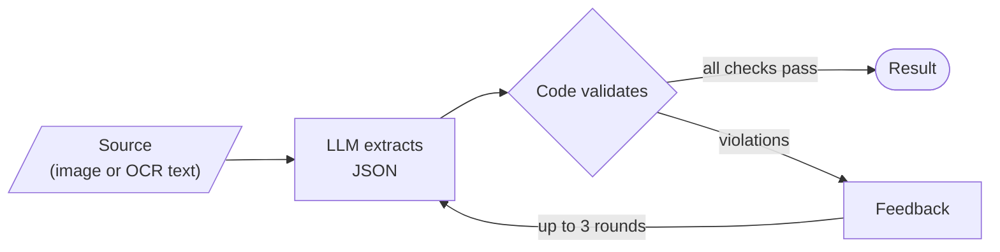
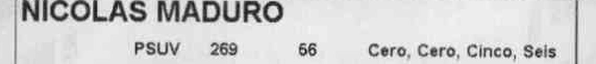
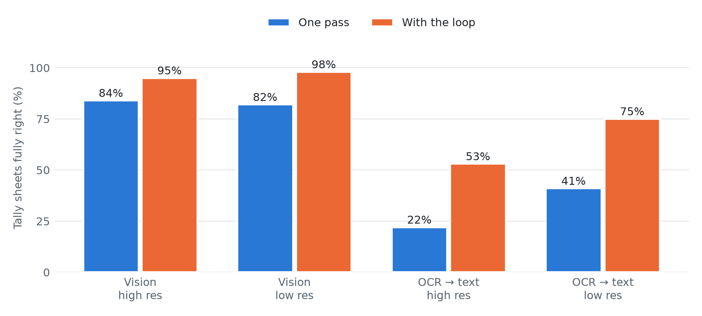

# llm-validation-loop

An LLM extracts data from a document, code checks the result, and failed checks
go back to the LLM for another try.

Written up in a blog post:
[English](https://rafaellcoellho.com/en/2026/10/11/the-llm-reads-the-code-checks/)
·
[Português](https://rafaellcoellho.com/2026/10/11/o-llm-le-o-codigo-confere.html).



## Example

Tally sheets from the 2024 Venezuelan presidential election, from
[Strvm/vnzla-libre](https://github.com/Strvm/vnzla-libre). They have real photos
and a QR code with the vote counts, used as ground truth.

Every number is printed twice, as digits and spelled out in Spanish:

<p align="center">
  
</p>

The validator checks that the party votes add up to the valid votes, that digits
match the words, and that the summary totals are consistent.

On sheet `050201001.01`, the model read the PSUV row as `66`. The validator
answered:

```text
Your answer in round 1 failed these checks:
- [digits_match_words] PSUV: digits say 66, but the words 'Cero, Cero, Cinco, Seis' say 56.
- [party_sum] The party votes add up to 491, but 'Votos validos' is 481 (difference +10).
```

In round 2 the model returned `56`.

## Results

200 sheets, read from the image and from OCR text, with `gemini-3.5-flash-lite`.

| Source     | One pass | With the loop |
| ---------- | -------: | ------------: |
| Vision     |    83.0% |         96.5% |
| OCR → text |    31.5% |         64.0% |

<p align="center">
  <picture>
    <source media="(prefers-color-scheme: dark)" srcset="results/figures/accuracy-dark.png">
    
  </picture>
</p>

Every run is saved in [`results/traces`](results/traces).

## Run it

Requires [uv](https://docs.astral.sh/uv/) and a Gemini API key.

```bash
make install-deps
cp .env.example .env
make images
make test
make run-vision
make run-ocr
make report
```
