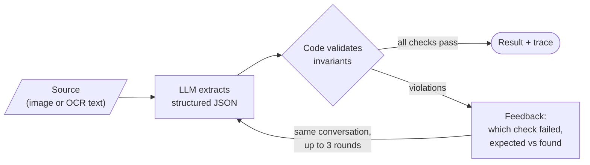
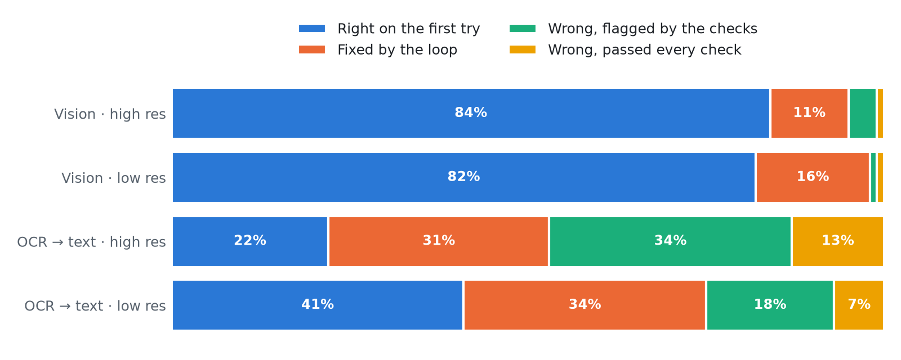

<h1 align="center">llm-validation-loop</h1>

<p align="center">
  <b>An LLM reads the document. Code checks the math. Failed checks go back to the LLM.</b><br>
  A small, tested reference implementation of LLM self-correction driven by a deterministic validator.
</p>

<p align="center">
  <picture>
    <source media="(prefers-color-scheme: dark)" srcset="results/figures/accuracy-dark.png">
    
  </picture>
</p>

## The technique

LLMs misread documents in ways that are hard to see and easy to verify. When the
document carries its own redundancy (totals, subtotals, values spelled out
twice) you can check the extraction with plain code and, when a check fails,
hand the failure back to the model and ask again.



**What this is not: LLM-as-a-judge.** There, another model decides whether an
answer is good. Here the judge is code: it can't be talked out of a wrong sum,
and it costs nothing to run.

|            | LLM-as-a-judge        | This loop                            |
| ---------- | --------------------- | ------------------------------------ |
| Who checks | another LLM call      | deterministic code                   |
| Verdict    | an opinion, may drift | pass / fail, reproducible            |
| Feedback   | free-text critique    | the exact rule, expected and found   |
| Works when | quality is subjective | the output has verifiable invariants |

In the literature this is **self-correction with external feedback** (Pan et
al., 2023). Without a reliable external signal, models tend not to fix their own
mistakes (Huang et al., 2023; Kamoi et al., 2024). In production libraries the
same idea is called _validation + reask_.

## The example: reading vote tallies from photos

The demo needs public documents with a known right answer. The 2024 Venezuelan
presidential election tally sheets (_actas de escrutinio_) fit: tens of
thousands of real photos and scans were published, and each sheet prints a QR
code with its own vote counts, which serves as the ground truth.

The QR code is cropped out before the model sees the sheet. It is only used to
score the result, never inside the loop.

Each sheet lists votes for **38 parties** that back **10 candidates**, and every
number is printed twice: as digits and spelled out in Spanish.

<p align="center">
  
</p>

That redundancy is what the validator checks:

| Rule                 | Check                                        |
| -------------------- | -------------------------------------------- |
| `party_sum`          | the 38 party votes add up to _Votos válidos_ |
| `digits_match_words` | `56` matches `Cero, Cero, Cinco, Seis`       |
| `summary_total`      | _Votos_ = valid + null + blank               |
| `machine_voters`     | voters on the machine = _Votos_              |
| `registered_voters`  | _Votos_ ≤ registered voters                  |
| `party_order`        | the 38 rows, in ballot order                 |

## One correction, end to end

Sheet `050201001.01`, read from the image. On the first try the model read the
PSUV row as **66**:

```json
{
  "party": "PSUV",
  "votes": { "digits": 66, "words": "Cero, Cero, Cinco, Seis" }
}
```

The validator answers in the same conversation:

```text
Your answer in round 1 failed these checks:
- [digits_match_words] PSUV: digits say 66, but the words 'Cero, Cero, Cinco, Seis' say 56.
- [party_sum] The party votes add up to 491, but 'Votos validos' is 481 (difference +10).

Look at the source again, only at the fields involved, and fix what was misread.
Do not change a value just to make a check pass: if a value really reads that
way, keep it. Return the complete JSON again.
```

Round 2 comes back with `"digits": 56`, every check passes, and the result
matches the QR code. Every run is saved as a trace in
[`results/traces`](results/traces).

## Results

200 sheets (100 high-res scans, 100 low-res), each read twice: once from image
crops (**vision**) and once from OCR text (**OCR → text**), with
`gemini-3.5-flash-lite`, up to 3 rounds per sheet.

| Source     | One pass | With the loop | Wrong, flagged | Wrong, passed every check |     Cost |
| ---------- | -------: | ------------: | -------------: | ------------------------: | -------: |
| Vision     |    83.0% |     **96.5%** |              5 |                         2 | US$ 1.55 |
| OCR → text |    31.5% |     **64.0%** |             52 |                        20 | US$ 2.51 |

<p align="center">
  <picture>
    <source media="(prefers-color-scheme: dark)" srcset="results/figures/outcomes-dark.png">
    
  </picture>
</p>

- **The loop never broke a right answer.** No sheet that was right on the first
  round ended wrong.
- **Vision gains the most where it matters.** The typical miss is a printed `5`
  read as `6`; the spelled-out digits settle it in one extra round.
- **OCR doubles its hit rate, but from a low base.** The OCR text is already
  corrupted (`Caro` for `Cero`, dropped digits), so the model is fixing errors
  it cannot see. That is also where the dangerous outcome grows: 10% of the
  sheets pass every check and are still wrong.
- **Flagged is not failed.** A sheet that never passes goes to a human with the
  exact rule that broke, which is far cheaper than reviewing everything.

Raw numbers: [`results/summary.json`](results/summary.json). One trace per sheet
and source: [`results/traces`](results/traces).

## What the checks cannot catch

Passing every check means the numbers are consistent, not that they are right.
Three cases from the run:

**The model can force the sum.** Sheet `181103005.01`, OCR source. The OCR line
for PCV lost its digit (`PCV  9  Cero, Cero, Core, Une`), the model wrote `0`,
and the sum came out 1 vote short. In round 2 it added that vote to CONDE, a row
the OCR read cleanly as `0`. Every check passed; two values were wrong. Of the
20 OCR sheets that passed while wrong, 17 got there this way, despite the
feedback saying _do not change a value just to make a check pass_. In another
sheet it read the totals as `608` while the words said `508`, then added 100
votes to PSUV to match.

**Some errors keep the sums intact.** Sheet `091002013.02`, vision source: one
vote landed on BR instead of DDP. Both parties back the same candidate, so every
total stays the same and no rule can notice.

**A degenerate answer satisfies everything.** Sheet `010107017.03`, vision
source: after a broken first round, the model returned a sheet of zeros. `0 = 0`
passes every sum.

The checks are only as strong as their independence from the values they check.
Ideas that would help, not implemented here: flag rounds that change fields the
feedback did not mention, add an anchor that does not come from the same table
(the voter count from the paper notebook, for instance), and send any sheet the
loop had to touch to a quick human look.

## When to use it

The loop paid off here because four things were true:

1. **There is a cheap deterministic check.** Sums and duplicated values, not
   opinions.
2. **The model can still see the evidence.** Errors it can re-read are fixable;
   errors baked into its input are not.
3. **The feedback is specific.** "PSUV: digits say 66, words say 56" beats
   "wrong, try again".
4. **Extra rounds only cost on failures.** In the vision run, 80% of the sheets
   passed on the first round; the whole run cost US$ 1.55 for 200 sheets.

Without a deterministic check you are back to an LLM judging an LLM, which is a
much weaker signal.

## Reuse the loop

The loop knows nothing about tally sheets. Bring an `extract` callable and a
`validate` function:

```python
from llm_validation_loop import Extraction, Violation, run_validation_loop


def validate(output):
    if sum(output["shares"]) == 100:
        return []

    return [
        Violation("shares_sum", f"shares add up to {sum(output['shares'])}%, not 100%")
    ]


def extract(history):
    ...  # call your LLM; replay history[i].output and build_feedback(history[i])
    return Extraction(output=parsed_json, usage=token_counts)


result = run_validation_loop(extract, validate, max_rounds=3)
```

[`src/tally_sheet/extractor.py`](src/tally_sheet/extractor.py) is a complete
`extract` for Gemini, with images or OCR text as the source.

## Project layout

```text
src/
├── llm_validation_loop/   the technique, domain-free
│   ├── loop.py            extract → validate → feed back, up to N rounds
│   ├── feedback.py        turns violations into the next prompt
│   └── attempt.py         Attempt, Violation, Extraction, LoopResult
└── tally_sheet/           the example domain
    ├── schema.py          JSON schema the model fills
    ├── rules.py           the deterministic checks
    ├── extractor.py       Gemini extractor (vision or OCR text)
    ├── ocr.py             RapidOCR → plain text
    ├── ground_truth.py    QR payload → expected values
    └── scoring.py         compares a result with the ground truth
scripts/                   sample, run, report
data/sample.json           the 200 sheets used (images are downloaded, not committed)
data/ocr/                  cached OCR text per sheet
results/                   traces, summary.json and figures
tests/                     rules, loop and extractor, no network
```

## Run it

Requires [uv](https://docs.astral.sh/uv/) and a Gemini API key.

```bash
make install-deps
cp .env.example .env   # set GEMINI_API_KEY
make images            # downloads the 200 sampled sheets
make test
make run-vision        # source: image crops
make run-ocr           # source: OCR text
make report            # results/summary.json and figures
```

## References

- Pan et al. (2023).
  [Automatically Correcting Large Language Models: Surveying the landscape of diverse self-correction strategies](https://arxiv.org/abs/2308.03188).
- Huang et al. (2023).
  [Large Language Models Cannot Self-Correct Reasoning Yet](https://arxiv.org/abs/2310.01798).
- Kamoi et al. (2024).
  [When Can LLMs Actually Correct Their Own Mistakes? A Critical Survey of Self-Correction of LLMs](https://arxiv.org/abs/2406.01297).
- Tally sheet images and decoded QR data:
  [Strvm/vnzla-libre](https://github.com/Strvm/vnzla-libre).
